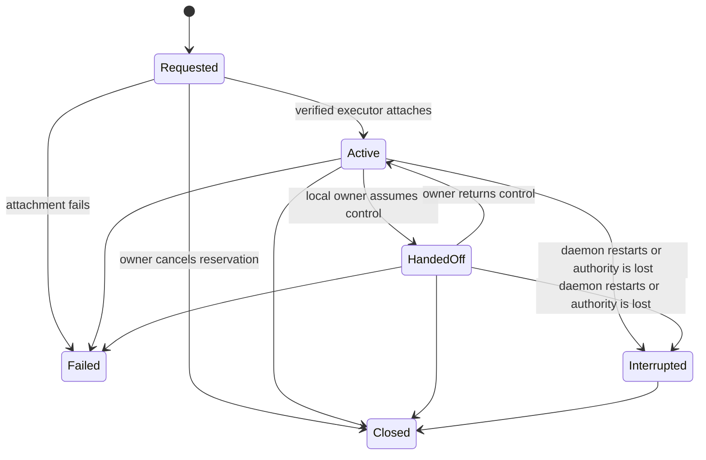

# Platform Capabilities And Sessions

- Status: M8 foundation implemented; persistent executors pending.
- Contract version: `PLATFORM_SCHEMA_VERSION = 1`.
- Date: 2026-08-14.

## Purpose

Browser automation, computer use, Sites, and typed SSH all depend on one answer
to two questions: what this installation can actually do, and who currently has
authority over a live host session. MCG records those answers before adding
long-lived executors so each interface and future tool uses the same custody and
recovery rules.

This contract does not expose the MCG control API remotely. All management routes
remain authenticated and loopback-only.

## Capability snapshots

At startup the runtime records an immutable, privacy-safe observation containing:

- operating-system and architecture identifiers;
- browser automation, computer use, native desktop, SSH client, and Sites
  availability;
- a bounded human-readable reason for each result; and
- observation time and schema version.

Snapshots exclude hostname, username, environment values, credentials, and
configured executable paths. Identical observations deduplicate by SHA-256 while
the stored record remains immutable. `available` means the current implementation
verified its prerequisite; `unavailable` and `unsupported` are distinct and are
never promoted merely because a future feature is planned.

## Durable session identity

Browser and computer-use reservations have a caller-owned UUID and a
server-generated SHA-256 hash of the exact definition. The definition binds kind,
optional project/task scope, display name, allowed origins, and bounded lifetime.
An exact retry returns the existing record. Reusing the UUID for different input
is a conflict.

Allowed browser origins are credential-free HTTP(S) origins only. Userinfo,
paths, queries, fragments, duplicate origins, non-network schemes, and more than
32 origins fail closed. Session metadata never contains cookies, tokens, page
content, keystrokes, screenshots, or SSH credentials.

## State and custody

`Requested` is a durable reservation, not evidence of execution. Only a concrete
executor may produce `Active`; only a real local-owner handoff may produce
`HandedOff`. Custody is `mcg` while active and `local_owner` while handed off.
Every state edge appends an immutable event in the same SQLite transaction that
updates the current projection.

Startup converts every live `Requested`, `Active`, or `HandedOff` record to
`Interrupted`, increments its recovery count, and retains the prior owner in the
event. Already-expired live records close with an immutable expiration event
before recovery, and reads settle any lifetime that elapsed while the daemon was
running. Authority is never silently reconstructed from stale process state.

## Storage and interfaces

SQLite migration 15 adds immutable capability snapshots, current session
projections, and immutable ordered session events. Creation, transition, and
restart recovery are atomic.

The same contract is exposed through:

- authenticated REST under `/api/v1/platform/*`;
- `mcg platform capabilities/list/request-browser/request-computer/history/close`;
- native Tauri commands and the Computer & Browser desktop dashboard; and
- MCP tools `mcg_platform_capabilities`, `mcg_platform_sessions`,
  `mcg_platform_request`, and `mcg_platform_close`.

The OpenAI-compatible provider endpoints intentionally remain provider APIs and
do not duplicate host-control management semantics.

## Next dependency

The next M8 layer attaches a persistent browser executor to this authority model.
It must preserve one browser profile/session across bounded operations, enforce
the recorded origin grant, prove attachment before activation, implement a real
local-owner handoff, and exercise restart/interruption behavior on Windows and
Linux. Computer use, Sites, and SSH then reuse the same authority contract rather
than inventing separate lifecycle rules.
