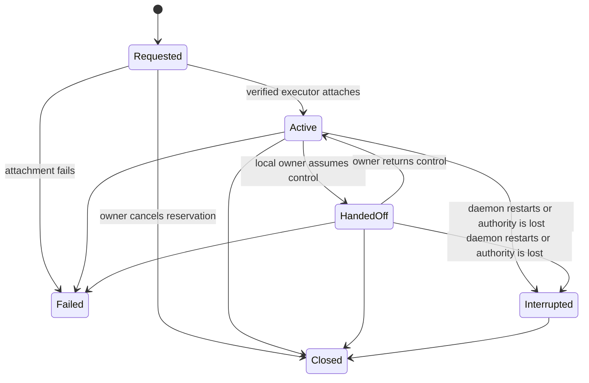

# Platform Capabilities And Sessions

- Status: M8 durable authority, persistent browser, and bounded computer executor implemented.
- Contract version: `PLATFORM_SCHEMA_VERSION = 1`.
- Date: 2026-08-14.

## Purpose

Browser automation, computer use, Sites, and typed SSH all depend on one answer
to two questions: what this installation can actually do, and who currently has
authority over a live host session. MCG records those answers before adding
long-lived executors so each interface and future tool uses the same custody and
recovery rules.

This contract does not expose the MCG control API remotely. All management routes
remain authenticated and loopback-only.

## Capability snapshots

At startup the runtime records an immutable, privacy-safe observation containing:

- operating-system and architecture identifiers;
- browser automation, computer use, native desktop, SSH client, and Sites
  availability;
- a bounded human-readable reason for each result; and
- observation time and schema version.

Snapshots exclude hostname, username, environment values, credentials, and
configured executable paths. Identical observations deduplicate by SHA-256 while
the stored record remains immutable. `available` means the current implementation
verified its prerequisite; `unavailable` and `unsupported` are distinct and are
never promoted merely because a future feature is planned.

## Durable session identity

Browser and computer-use reservations have a caller-owned UUID and a
server-generated SHA-256 hash of the exact definition. Browser definitions bind
optional project/task scope, display name, allowed origins, and bounded lifetime.
Computer definitions instead bind the display/region target and explicit
capabilities; browser hashes remain byte-compatible with the original contract.
An exact retry returns the existing record. Reusing the UUID for different input
is a conflict.

Allowed browser origins are credential-free HTTP(S) origins only. Userinfo,
paths, queries, fragments, duplicate origins, non-network schemes, and more than
32 origins fail closed. Session metadata never contains cookies, tokens, page
content, keystrokes, screenshots, or SSH credentials.

## State and custody

`Requested` is a durable reservation, not evidence of execution. Only a concrete
executor may produce `Active`; only a real local-owner handoff may produce
`HandedOff`. Custody is `mcg` while active and `local_owner` while handed off.
Every state edge appends an immutable event in the same SQLite transaction that
updates the current projection.

Startup converts every live `Requested`, `Active`, or `HandedOff` record to
`Interrupted`, increments its recovery count, and retains the prior owner in the
event. Already-expired live records close with an immutable expiration event
before recovery, and reads settle any lifetime that elapsed while the daemon was
running. Authority is never silently reconstructed from stale process state.

## Persistent browser executor

Attaching a browser launches one Chromium process and page in a session-specific
ephemeral profile. Activation is committed only after Chromium, the page, request
interception, and download denial are live. A failed attachment leaves the durable
reservation `Requested` and removes the partial profile.

Browser sessions require at least one immutable allowed origin. Every main-frame
and subresource request is intercepted: only `GET` and `HEAD` requests inside the
grant are continued; credential-bearing URLs, cross-origin traffic, mutations,
and downloads fail closed. Navigation responses expose only a query- and
fragment-free URL, title, mode, handoff state, and denied-request count. Cookies,
page content, credentials, and profile paths never cross the API boundary.

Headless sessions cannot be handed off. A visible session stops accepting MCG
operations before durable custody moves to `local_owner`. Returning custody first
navigates to `about:blank`, preventing MCG from reading content the owner entered
while in control. Closing or expiring a session terminates Chromium and removes
its isolated profile. On daemon startup, stale profile directories are removed
after live durable records have been interrupted.

## Computer-use executor

Computer attachment resolves either the primary display or one explicit display
identifier and permanently confines the session to that display-relative region.
Every grant includes `screen_read`; `mouse` and `keyboard` are separate. Clipboard,
window enumeration, and process inspection are advertised as unavailable until an
equally bounded implementation exists. Input supports typed move, click, scroll,
text, and allowlisted-key actions only. Keyboard input requires an earlier click
inside the region in the same batch, and every coordinate is revalidated.

Capture returns a bounded PNG and SHA-256 digest. Immediately before input, the
executor captures again under the same manager lock and requires an exact digest
match. Changed pixels reject the batch without input. Handoff blocks capture and
input; reclaim returns authority without automatically reading the owner's screen.

Each input request has a caller-owned batch UUID. Migration 16 durably claims the
request hash before host input and records `executing`, `succeeded`, `rejected`, or
`uncertain`. Exact successful retries are observation-only; changed UUID reuse is a
conflict. A crash after claim can leave the side effect unknowable, so startup
converts `executing` to `uncertain` and never automatically replays it. Request
hashes and durable records contain action structure but never typed text or pixels.

Input uses the same durable policy broker as every other host mutation. The exact
computer session is an explicit capability resource, Guided mode creates a durable
approval before any action-batch claim or host input, and Balanced/Autonomous modes
may proceed only inside that grant. Policy decisions, leases, failed execution, and
successful completion are written to the immutable tool audit. The caller batch UUID
is mapped into a namespaced stable tool-request identity, so approval retries remain
idempotent without allowing a caller-owned UUID to collide with another tool request.
When a session is not task-bound, its audit uses a namespaced synthetic authority
subject until the storage schema supports first-class non-task audit subjects.

Windows uses the native capture/input backends. The initially qualified Linux path
is an owner-session X11 display with `DISPLAY` available to the daemon; a headless
daemon truthfully reports computer use unavailable, and Wayland input remains
unqualified. This limitation must be visible in packaging and release notes until
native Wayland support passes the same safety and UAT gates.

## Storage and interfaces

SQLite migration 15 adds immutable capability snapshots, current session
projections, and immutable ordered session events. Migration 16 adds the durable,
non-deletable computer input ledger. Creation, transition, and restart recovery are
atomic.

The same contract is exposed through:

- authenticated REST under `/api/v1/platform/*`;
- `mcg platform capabilities/list/request-browser/request-computer/attach/navigate/handoff/reclaim/history/close`;
- native Tauri commands and the Computer & Browser desktop dashboard; and
- MCP tools `mcg_platform_capabilities`, `mcg_platform_sessions`,
  `mcg_platform_request`, `mcg_platform_close`, `mcg_browser_attach`,
  `mcg_browser_navigate`, `mcg_browser_handoff`, `mcg_browser_reclaim`, and the
  `mcg_computer_attach/capture/actions/handoff/reclaim` family.

The OpenAI-compatible provider endpoints intentionally remain provider APIs and
do not duplicate host-control management semantics.

## Next dependency

Sites and typed SSH reuse this authority contract rather than inventing separate
lifecycle rules. Computer control has passed native Windows/Linux automated
qualification and agent-performed UAT, including durable policy, approval, lease,
audit, exact replay, handoff privacy, and crash-recovery boundaries.

The Sites registry, deployment, and monitoring contract is defined separately in
[`sites.md`](sites.md); it reuses durable approval, audit, lease, scheduler, and
artifact primitives but is not modeled as a live desktop-custody session.

Typed outbound SSH is defined in [`typed-ssh.md`](typed-ssh.md). It reuses policy,
approval, leases, audit, artifacts, and crash uncertainty without exposing the MCG
control API or treating a remote machine as a browser/computer custody session.
