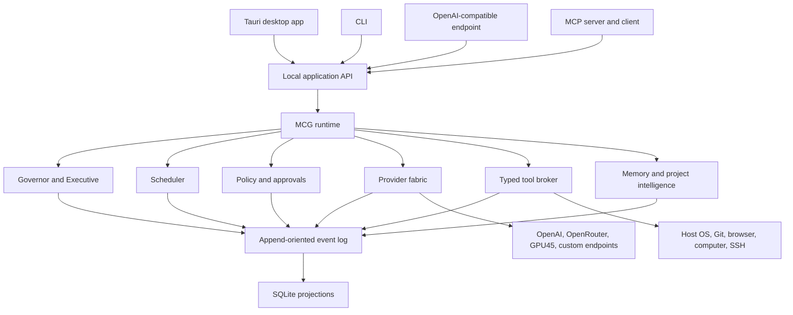

# MCG Implementation Architecture

- Status: Initial implementation baseline.
- Date: 2026-08-14.
- Governing requirements: `docs/spec/` and ADR 0001.

## Architectural shape

MCG is a local-first system centered on one persistent daemon. Every interface is
a client of the same versioned application contracts.



The daemon binds to loopback only in the initial product. The GUI may launch it
for first-run convenience, but daemon state, task recovery, and scheduling do not
depend on an open GUI window.

## Workspace boundaries

The Rust workspace uses small crates with one-way dependencies:

| Crate/application | Responsibility |
|---|---|
| `mcg-domain` | Stable IDs, task envelopes, state machines, capability and organization value types. |
| `mcg-events` | Versioned event envelopes, event kinds, and event serialization. |
| `mcg-config` | Layered configuration and simple/advanced user settings. |
| `mcg-storage` | SQLite migrations, transactions, event persistence, and projections. |
| `mcg-policy` | Owner constitution, autonomy presets, capability decisions, and approvals. |
| `mcg-providers` | Canonical model requests, provider discovery, authentication references, streaming, cost metadata, and probes. |
| `mcg-tools` | Typed tool schemas, execution leases, process/filesystem/Git primitives, and result capture. |
| `mcg-runtime` | Task orchestration, Executive, scheduler integration, agents, evaluation, and MCG observation. |
| `mcg-api` | Local REST and event-stream contracts plus OpenAI-compatible and MCP adapters. |
| `mcg-daemon` | Process lifecycle, dependency wiring, recovery, signals, and local server. |
| `mcg-cli` | Interactive, one-shot, JSON, and streaming terminal client. |
| `apps/desktop` | React UI and Tauri host using the same application contracts. |

Domain crates do not depend on transports, SQLite, Tauri, or provider SDKs.

The implemented M2 contracts and invariants are detailed in
[`provider-fabric.md`](provider-fabric.md).
Provider, tool, and storage implementations depend on domain contracts; runtime
orchestrates them through traits. API clients never reach storage directly.

## Process and contract model

The daemon exposes a versioned loopback HTTP API and server-sent/WebSocket event
stream. A random installation secret authenticates local clients so unrelated
local processes cannot control MCG merely because the port is reachable. The
secret is stored in the OS credential manager and conveyed to bundled clients by
an OS-restricted bootstrap mechanism.

Initial route families:

```text
/api/v1/system/*
/api/v1/projects/*
/api/v1/threads/*
/api/v1/tasks/*
/api/v1/providers/*
/api/v1/models/*
/api/v1/approvals/*
/api/v1/schedules/*
/api/v1/organization/*
/api/v1/events

/v1/models
/v1/responses
/v1/chat/completions

/mcp
```

Transport DTOs are versioned separately from internal domain types. Breaking
changes require a new route or negotiated protocol version. The CLI and desktop
app use generated TypeScript/Rust client contracts once schemas stabilize.

## State, events, and recovery

SQLite is the canonical operational store. Large tool output, snapshots, media,
and replay artifacts live in content-addressed filesystem storage referenced by
hash from SQLite.

Every accepted command runs in a transaction that records an immutable event and
updates current-state projections. Important records include:

- projects, threads, tasks, runs, leases, and agent instances;
- organization and prompt revisions;
- provider connections, model observations, capabilities, and prices;
- tool requests, approval decisions, executions, and artifacts;
- schedules, wake requests, experiments, evaluations, and metrics;
- memory claims with provenance, confidence, scope, and freshness.

On startup, the daemon migrates the database, marks interrupted leases for
recovery, reconciles running child processes, and resumes only work whose policy
permits unattended continuation. Replay reconstructs decisions from recorded
inputs while acknowledging nondeterministic external services.

## Provider fabric

Providers implement one canonical streaming interface. Discovery combines:

1. declared connection configuration;
2. `/models` or provider-native model listing;
3. known provider metadata with a freshness date;
4. safe capability probes;
5. observed task performance and failures.

Authentication modes are explicit connection properties:

- ChatGPT/Codex browser OAuth — encouraged when available;
- ChatGPT/Codex device code — encouraged for callback-constrained environments;
- OpenAI API key — fully supported when chosen by the user;
- OpenRouter API key;
- arbitrary bearer/header/environment credential references;
- no authentication for trusted local endpoints such as GPU45 when configured.

OAuth and API-key connections are distinct. A failure never silently changes the
connection's billing mode. Secrets remain behind a credential-store interface and
are resolved only at the network boundary; they are excluded from events, logs,
model context, backups, and debug exports.

The initial OAuth implementation is isolated behind a provider-auth trait. It may
reuse license-compatible pieces of OpenAI's Rust `codex-login` implementation,
but the model/runtime integration must not depend on the Codex agent harness.

## Tasks, agents, and governance

User intent becomes a `TaskEnvelope` containing goal, success conditions, risk,
budget, permissions, provenance, and project scope. A run binds that envelope to
specific organization, policy, prompt, provider, and model revisions.

The Executive selects the smallest organization capable of the task. Agents act
under bounded leases. Tool and model usage emits events consumed by evaluators
and MCG observers. Initial MCG behavior is deterministic and explainable:

- repeated-action and no-progress detection;
- budget and lease thresholds;
- model/provider error escalation;
- confidence/evidence gaps;
- excessive organizational overhead;
- conflicting evaluator results.

MCG recommendations become versioned proposals. Automatic prompt, routing, and
organization changes are enabled progressively by autonomy settings, scenario
evidence, reversible configuration revisions, and owner constitution limits.

## Tool and policy boundary

Agents cannot execute arbitrary host operations directly. They submit typed tool
requests containing executable/operation, arguments, working directory, path and
network scopes, expected effects, timeout, and risk classification.

Policy returns one of `allow`, `deny`, or `require_approval`, including an
explanation and matched constitutional rules. The default autonomous preset allows
project-local reads, reversible writes, builds, tests, and approved tools. It
requires approval for destructive deletion, secrets, purchases, publication,
Git push, deployment, privilege elevation, and policy changes.

Process execution avoids shell interpretation by default. Shell execution is a
separate capability. Tool outputs are size-bounded, redacted, artifact-backed,
and linked to the exact request and task lease.

## Memory and project intelligence

Project discovery begins with repository root, instructions, Git state, languages,
build/test systems, and known commands. Deeper indexing and world-model inference
run incrementally. File watchers invalidate affected facts rather than rebuilding
the entire index.

Memory is split into active context, human-readable managed memory, structured
claims, and optional semantic indexes. Every durable claim has scope, provenance,
confidence, observed time, and freshness policy. Retrieval is permission-aware and
never crosses projects merely because embeddings are similar.

## Product surfaces

Normal desktop mode presents projects, conversations, goals, progress, approvals,
cost, and results. Advanced mode adds organization, models, tools, memory,
scheduler, experiments, raw events, and configuration revisions. The switch alters
presentation density, not security policy or hidden behavior.

The CLI supports interactive, one-shot, piped, JSON, and streaming JSON modes.
OpenAI-compatible and MCP adapters preserve caller-owned tools and maintain clear
`caller`, `host`, and `mcg` namespaces.

## Platform and packaging

Windows, Linux, and macOS installers are produced from the same source and bundle
the daemon, CLI, desktop UI, migrations, and web assets. Windows and Linux are the
initial qualified platforms. macOS packages are explicitly marked best-effort
until macOS owner-controlled build and real-device tests are available.

Android reuses portable domain/runtime crates but exposes a capability profile
rather than pretending desktop process, filesystem, and browser access exists.

## Design constraints

- No model output is trusted as authorization or proof of success.
- No MCG action can weaken the owner constitution or audit log.
- No provider authentication mode changes implicitly.
- No interface owns private business logic unavailable to the others.
- No self-improvement is promoted without measurements and a rollback revision.
- No external side effect bypasses the typed tool and policy boundary.
