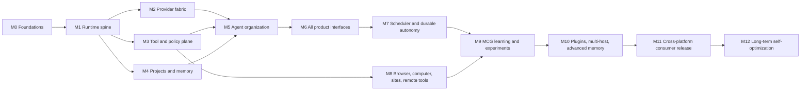

# Dependency-Ordered Delivery Milestones

This roadmap covers the complete PRD. Milestones are integration checkpoints, not
scope reductions. A capability is complete only when its shared contracts, daemon
behavior, GUI/CLI/API exposure, policy handling, persistence, and automated tests
are present where applicable.

## Dependency map

## M0 — Repository and engineering foundations

Deliver:

- Rust workspace and stable crate boundaries.
- React/Tauri desktop shell and root build orchestration.
- Formatting, linting, unit-test, contract-test, and E2E harnesses.
- Local Windows/Linux verification scripts and best-effort macOS packaging workflow design.
- Architecture, security, migration, and contribution conventions.

Exit evidence: clean checkout can format, build, test, and start the daemon/CLI;
desktop assets build; documented local verification mirrors release commands.

## M1 — Runtime spine

Deliver:

- Versioned domain identifiers, task envelopes, state machines, and events.
- SQLite migration runner, event store, projections, artifact store, and recovery.
- Loopback daemon API, local client authentication, health, status, and streaming.
- Structured configuration, tracing, redaction, shutdown, and crash recovery.

Exit evidence: a task created through the API survives daemon restart and its event
history/projection agree under migration and recovery tests.

## M2 — Provider fabric

Deliver:

- Canonical request, response, streaming, tool-call, and usage types.
- OpenAI OAuth browser/device flows and explicit API-key mode.
- OpenRouter and arbitrary OpenAI-compatible connections.
- GPU45 live development adapter and opt-in contract suite.
- `/models` discovery, capability probes, cost provenance, routing rules, retries,
  rate limits, fallback policy, and user model pinning.

Exit evidence: the same conformance suite passes against deterministic fakes,
OpenAI-compatible fixtures, and opted-in live connections; billing modes never
change implicitly.

## M3 — Typed tools, capabilities, and approvals

Deliver:

- Filesystem, structured process, shell, Git, HTTP, system, and memory primitives.
- Capability policies, owner constitution, autonomy presets, approval lifecycle,
  secret isolation, output redaction, leases, and artifact capture.
- Worktree isolation and conflict-aware patch application.

Exit evidence: adversarial tests cannot bypass protected paths or approval gates;
all actions have audit events and externally observable verification.

## M4 — Projects, context, and memory

Deliver:

- Project discovery and hierarchical instruction resolution for AGENTS, Claude,
  Cursor, README, and contribution files.
- Conflict detection, build/test command discovery, Git/project model, and watches.
- Active context compression, managed memory, structured claims, lifecycle,
  provenance, freshness, and optional semantic indexing.

Exit evidence: fixture repositories produce stable project models, conflicts are
surfaced, and context/memory behavior survives correction and restart scenarios.

## M5 — Organization and useful work

Deliver:

- Executive, Conversation, Coder, Evaluator, and Tool Worker roles.
- Organization genome, roles/instances, task decomposition, leases, budgets,
  confidence, success conditions, and minimal-organization selection.
- First complete website/application projects using real tools and providers.

Exit evidence: representative projects can be created, modified, built, tested,
and evaluated end-to-end with replayable evidence and bounded organizational cost.

## M6 — Complete interface family

Deliver:

- Consumer desktop flows for onboarding, providers, projects, threads, tasks,
  approvals, diffs, results, costs, organization, settings, and developer mode.
- Interactive/one-shot/piped/JSON/streaming CLI.
- OpenAI-compatible `/v1/models`, `/v1/responses`, and chat-completions adapter.
- MCP client/server foundation and caller/host/MCG tool namespace semantics.

Exit evidence: one task can be initiated and observed from every interface with
identical state, policy, and result semantics.

## M7 — Scheduler and durable autonomy

Deliver:

- Cron, event triggers, watches, wake conditions, adaptive heartbeat, and leases.
- Persistent background work, restart recovery, notification, history, and UI.
- Budget-aware unattended approval policy and safe pause behavior.

Exit evidence: scheduled and watched tasks survive restarts without duplicate side
effects and stop reliably at approval/budget boundaries.

## M8 — Expanded execution plane

Deliver:

- Persistent browser sessions and handoff.
- Computer-use sessions with platform capability advertising.
- Sites, deployment knowledge, health checks, logs, and monitoring.
- SSH as a typed remote-execution tool without exposing the MCG control API.

Exit evidence: browser/site/computer/SSH scenarios verify real outcomes and policy
boundaries on supported Windows/Linux environments.

## M9 — Measured metacognitive improvement

Deliver:

- Fast/medium/slow supervision loops and intervention levels.
- Model calibration, failure-pattern detection, overhead metrics, and escalation.
- Shadow models/organizations, experiment engine, prospective simulation,
  promotion/reversion, configuration diffs, and scenario benchmarks.

Exit evidence: seeded regressions are detected and reverted; shadow execution
cannot affect real outcomes; every promoted change links to measured evidence.

## M10 — Extensibility and advanced operation

Deliver:

- Trusted native and capability-restricted WASI plugin systems.
- Advanced project world model, provenance graph, organization inheritance,
  multi-host workflows, replay tooling, and advanced memory lifecycle.
- Portable organization genomes, backup/restore bundles, and encrypted secret opt-in.

Exit evidence: plugins fail closed, backups restore evolved organizations, and
candidate configurations reproduce benchmark results within declared tolerance.

## M11 — Consumer release completion

Deliver:

- Signed Windows/Linux/macOS packages, updater, migration/rollback, onboarding,
  accessibility, diagnostics, recovery, and privacy controls.
- Performance, soak, chaos, installer, upgrade, and backup qualification.
- Simple/advanced UX refinement across multiple real projects.

Exit evidence: equivalent release gates pass on Windows, Linux, and macOS;
platform-specific capability differences are explicit; routine regression testing
is automated.

## M12 — Long-term roadmap

Deliver:

- Sophisticated self-optimizing organizations and cross-project learning controls.
- Distributed execution beyond SSH, fleet management, organization sharing,
  advanced ensembles, predictive intervention, and long-term operational workflows.
- Android capability-profile application using portable core components.

Exit evidence: each feature has an explicit threat model, opt-in boundary,
benchmark/evaluation suite, and reversible migration path.

## Continuous requirements

Every milestone maintains:

- owner constitution enforcement and complete auditability;
- schema/API/config backward compatibility or explicit migrations;
- deterministic fixtures plus opt-in live evaluations;
- cost, latency, resource, attention, risk, and organizational-overhead metrics;
- documentation and `MEMORY.md` updates at meaningful checkpoints.
